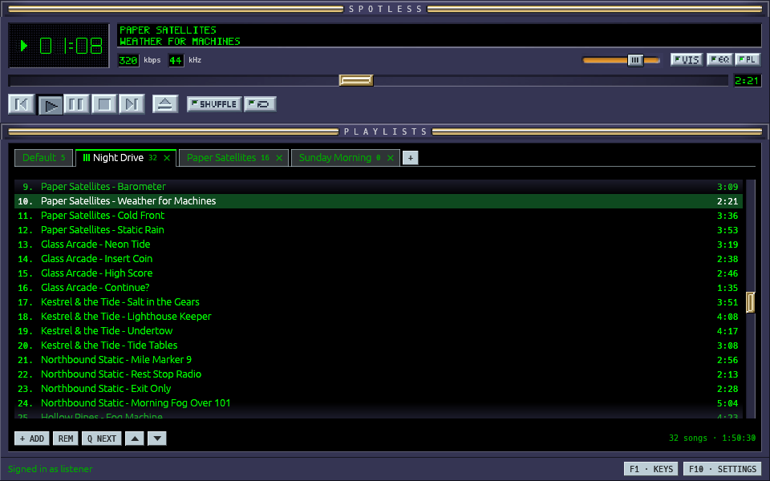
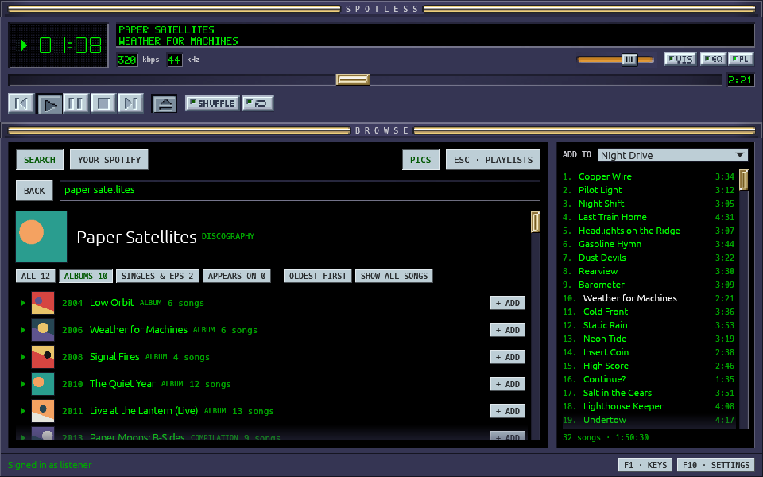
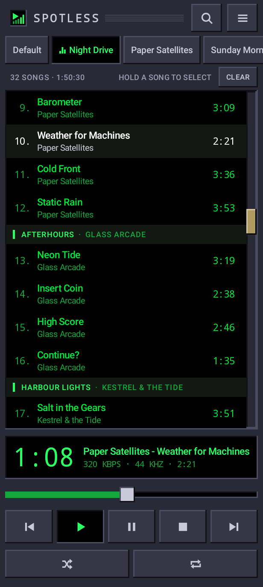

# Spotless

A small, fast Spotify player for the desktop and Android phones, in the
spirit of Winamp.
Local playlists, a straight path to any artist's albums, and nothing else in
the way.

Spotless runs on Linux, Windows and Android, and needs a Spotify Premium
account.


## Screenshots

The Winamp Classic look, playing a playlist and browsing an artist's albums:





The Android app:



## The name

**Spotless** is *Spotify* with *less*:

- **Less Spotify**: less of Spotify's design, its screens, its feeds and its
  way of doing things.
- **Less**, as in less of everything: a minimal player with only what you use.
- And **spotless** as in clean and neat: an interface without the noise and
  clutter.

## Why

Spotify's own app has frustrated me for years:

- **It's slow.**
- **It's noisy.** It's cluttered with things I don't need or rarely use:
  artist promotions, recommendations, recent listens and more.
- **What I do use is hard to reach.** Listening to albums means going back and
  forth between screens, and coming back often loses the place you scrolled
  to.
- **It can't be navigated with the keyboard.** There are a few shortcuts,
  but getting around (searching, opening an artist, picking an album,
  adding it) takes the mouse.
- **The queue works against you.** It's one queue for all your devices, so
  a computer can't play its own without overwriting your phone's. Press Play
  on an album and the rest of its songs go behind your queue, where nothing
  clears them (someone made a silent track just for that). And you can't put
  an album first for a while without wrecking the queue you had.

Spotless is the player I wanted instead.

## How it's different

| | Spotify's app | Spotless |
|---|---|---|
| What plays | One queue, synced across your devices | Playlists kept on this computer; other devices are left alone |
| Playing an album | Play replaces part of the queue; Add to queue puts it at the end | Add it to any playlist, or press Q to play songs next, without losing anything |
| After a song plays | It's gone from the queue | It stays; the playlist just moves on, so you can go back |
| Finding albums | Several screens, and the scroll position is lost | Search, then an artist's albums in date order, with songs opening inline |
| The screen | Home feeds, recommendations, podcasts and more | A player, your playlists, and the catalogue when you ask for it |
| The keyboard | A few shortcuts | Everything works from the keyboard (F1 lists the keys) |

## Who it's for

- **People who miss Winamp**, or players like it (AIMP, foobar2000,
  MediaMonkey): one compact window, a playlist you build yourself, and a
  player that does what you tell it.
- **Anyone who wants a simpler Spotify**: fewer screens, nothing competing
  for attention, just finding music and playing it.
- **Album listeners**, who want an artist's albums in order and whole
  albums in their playlists, without the detours.
- **Keyboard users**: every action has a key.
- **Anyone using several devices** who wants this computer's music to stay
  separate from the phone's.

It isn't for you if you rely on Spotify's own playlists, recommendations
or podcasts, or if you don't have Premium: Spotless leaves those out, and
Spotify only allows playback in other apps for Premium accounts.

## Features

- **Local playlists in tabs.** As many as you like, saved between sessions. A
  *Default* playlist is always there. Rename a tab by double-clicking it;
  reorder songs and tabs by dragging.
- **Playlists aren't used up.** Playing a song doesn't remove it: each
  playlist has its own place, which you can move back and forth, and
  viewing another tab never changes what plays. At the end, playback stops
  and goes back to the top (or loops, with Repeat).
- **Play next.** Mark songs with `Q` to play them next, in order, without
  moving them. Marks clear once they've played.
- **Shuffle and Repeat**, where Previous goes back through what actually
  played.
- **Gapless playback** at 320 kbps, with optional volume levelling.
- **One stream at a time**, as Spotify allows. Start playing on your phone
  and Spotless pauses; press play in Spotless and it pauses your phone.
  Spotless watches your devices through Spotify Connect without showing up
  in their lists, and its own playback stays out of your account's queue.
- **The Spotify tab**, optional: your account's queue, as Spotify's own
  apps show it, with Spotless as a Spotify Connect device to play it on.
  What played, the song playing, then the songs queued and the rest of the
  album or playlist. Play a song of it to take the queue over; while another
  device holds it, the tab only shows it until you **TAKE OVER**, and the
  player's buttons control that device. Add songs from Browse, remove them,
  clear the queue, or copy its songs to a playlist. Close the tab and
  Spotless leaves Connect; *Settings > Playback* turns it off.
- **Browse**: search shows Artists, Albums and Songs separately. An artist's
  page is just the discography: All, Albums, Singles & EPs, Appears on;
  Albums first, oldest first, songs opening inline. **+ ADD** adds a whole
  album to the playlist shown alongside. Pasting a Spotify link adds it too.
- **Pics are optional**: album covers and artists' pictures. Off by default
  on the desktop, on by default on Android; either way, they show in the
  catalogue only. Playlists stay text.
- **Last.fm scrobbling**, optional, sent by Spotless itself. Spotify's
  Last.fm link only hears of what plays through Spotify Connect, which
  Spotless's playlists stay out of so they never take over your account's
  queue.
  Listens made offline are sent later. The same API key gives an artist's
  page **Similar**: the artists Last.fm's listeners play alongside it.
- **Made for the keyboard.** Everything works without the mouse: playback,
  moving between tabs and through playlists, searching and browsing an
  artist's albums, adding them, and Settings. F1 lists the keys.
- **Your desktop's controls**: media keys, the system's now-playing display
  (MPRIS on Linux, the media overlay on Windows), and a tray icon; closing
  the window keeps Spotless playing there.
- **Two looks**: Spotless Classic, and Winamp Classic, drawn with Winamp's
  own buttons, digits, font, seek bar and volume. Pick one in Settings >
  Display.
- **Monitor colours**: the songs, the time and the song's name in the green
  of old terminals, or in amber, paper-white, a hi-fi's fluorescent
  teal, ice blue, deep blue or purple.
- **Settings** (F10): account, search, Last.fm, audio output, volume levelling,
  interface size, skin and colour, tray, and the audio and cover caches.
- **One window, one copy**: starting Spotless again brings the running one
  forward.

## Install

### Windows

1. Download `spotless-<version>-windows-x64.zip` from the
   [Releases](https://github.com/nix-codes/spotless/releases) page.
   Until there's a release, the latest build is on the
   [Actions](https://github.com/nix-codes/spotless/actions) page: open the
   newest successful run and download **spotless-windows-x64** under
   *Artifacts*.
2. Unzip it and run **install.cmd**. It installs Spotless for your user only
   (no administrator needed) to `%LOCALAPPDATA%\Programs\Spotless`, adds it to
   the Start menu, and lists it under *Settings > Apps* for uninstalling.
   Run it again to update.

   Or skip installing: `Spotless.exe` runs on its own from any folder.
3. Spotless isn't signed, so the first start may show *"Windows protected
   your PC"*: choose **More info**, then **Run anyway**.

To uninstall, use *Settings > Apps > Installed apps > Spotless*, or run
`uninstall.cmd`.

### Linux

There are no packages yet: Spotless is built from source, which takes a few
minutes the first time.

1. Install [Rust](https://rustup.rs) and the ALSA headers:
   - Debian, Ubuntu: `sudo apt install build-essential pkg-config libasound2-dev`
   - Fedora: `sudo dnf install gcc pkgconf-pkg-config alsa-lib-devel`
   - Arch: `sudo pacman -S base-devel alsa-lib`
2. Build and install it for your user:

   ```sh
   git clone https://github.com/nix-codes/spotless.git
   cd spotless
   packaging/install.sh
   ```

   This installs `~/.local/bin/spotless` and a launcher with its icon. Run it
   again after `git pull` to update; `packaging/uninstall.sh` removes it.

On Linux, choosing the audio output needs PipeWire or PulseAudio (`pactl`),
and the tray icon needs a panel that shows StatusNotifierItem icons (KDE,
most others; on GNOME, the AppIndicator extension).

### Android

For 64-bit phones on Android 10 or later.

1. On your phone, download `spotless-android-<version>-arm64.apk` from the
   [Releases](https://github.com/nix-codes/spotless/releases) page (the
   releases named *Spotless for Android*).
2. Open it to install it. Android asks once to allow installing apps from
   your browser or file manager.
3. Spotless isn't on Google Play, so Play Protect may warn that it doesn't
   know the app: choose to install it anyway.

To update, install a newer release's APK over it; your playlists and
sign-in stay. [Obtainium](https://github.com/ImranR98/Obtainium) can watch
the Releases page and install new versions for you.

Each release lists the SHA-256 fingerprint of the certificate it's signed
with; every release is signed with the same one.

## First start

On Android, *Settings* is the ☰ button at the top, and the Client ID goes
under *Search* there, with **CONNECT** to approve it.

1. **Sign in.** Click *Sign in with Spotify*: your browser opens once for
   Spotify's approval, and Spotless remembers it.
2. **Set up search** (once). Spotify only lets third-party players search
   through a Spotify app of your own, which is free to make:
   1. Create an app at
      [developer.spotify.com/dashboard](https://developer.spotify.com/dashboard).
   2. Add `http://127.0.0.1:8989/login` as its Redirect URI, and tick
      **Web API**.
   3. Paste the app's Client ID in Spotless: *Settings (F10) > Account*.
      Your browser asks once more, to approve search.

   The steps are also in that settings page, with a button to copy the
   Redirect URI. Playlists and playback work without it; only search needs
   it.

3. **Connect Last.fm** (optional, once). Last.fm needs an API account of
   your own, also free:
   1. Create one at
      [last.fm/api/account/create](https://www.last.fm/api/account/create).
      Any application name will do; leave the callback URL empty.
   2. Paste its API key and shared secret in *Settings (F10) > Last.fm* and
      click **CONNECT**. Your browser asks you to allow Spotless.

   **Why an API account of your own?** Linking Last.fm in your Spotify
   account doesn't help here: Spotify only scrobbles what plays through
   Spotify Connect, and a player that joins Connect takes over your
   account's playback, replacing the queue on your other devices. So
   Spotless's playlists stay out of Connect and Spotless scrobbles them by
   itself. To do that, Last.fm requires every app to sign its requests
   with an API key and a shared secret; unlike Spotify, it has no sign-in
   that works without a secret. A key built into Spotless would put that
   secret in public source code, where anyone could copy and misuse it,
   and every Spotless user would share its limits and lose scrobbling if
   Last.fm revoked it. Your own API account is used only by your copy of
   Spotless.

Press **F1** at any time for the keys.

## Your data

Your settings and playlists stay on your computer:

| | Linux | Windows |
|---|---|---|
| Settings, playlists, sign-in | `~/.config/spotless` | `%APPDATA%\spotless` |
| Audio and cover caches | `~/.cache/spotless` | `%LOCALAPPDATA%\spotless` |

Uninstalling keeps these; delete the folders to remove them too.

## Building from source

```sh
cargo run --release
```

The toolchain version is pinned in `rust-toolchain.toml`; rustup picks it up
on its own. On Windows, building also needs the Visual Studio Build Tools.
The Windows zip can be built from Linux with `packaging/windows/build.sh`,
using Rust's `x86_64-pc-windows-gnullvm` target and
[llvm-mingw](https://github.com/mstorsjo/llvm-mingw).

## Releasing

The Android app is released from `main` with a tag, `android-v<version>`:

```sh
packaging/android/release.sh 0.2.0
```

The script checks that `main` matches GitHub's, that CI passed on it and
that the version goes up, then pushes the tag. GitHub Actions builds the APK,
signs it with the release key in the repository's secrets and makes a draft
release with the changes since the last one. Install the draft's APK, try it,
then publish the release. The tag is the only place the version is set.

## Status

Spotless is young. Linux is its main platform; the Windows build is new and
has only been tested under Wine and on GitHub's build machines so far. The
Android app is newer still, and has been tried on one phone.

Not there on purpose: Spotify's own playlists, podcasts, and anything
social. Maybe later: an equalizer, importing Spotify playlists.

## Credits

Spotless started from [spotifast](https://github.com/crmne/spotifast) by
Carmine Paolino: its sign-in, playback and catalogue code were the base this
player was trimmed and reshaped from.

It plays through [librespot](https://github.com/librespot-org/librespot)
(a fork with a few fixes not yet released) and draws its window with
[egui](https://github.com/emilk/egui).

Spotless is not made or endorsed by Spotify. Spotify is a trademark of
Spotify AB.

## License

MIT: see [LICENSE](LICENSE). It covers Spotless and the code that came from
spotifast.
