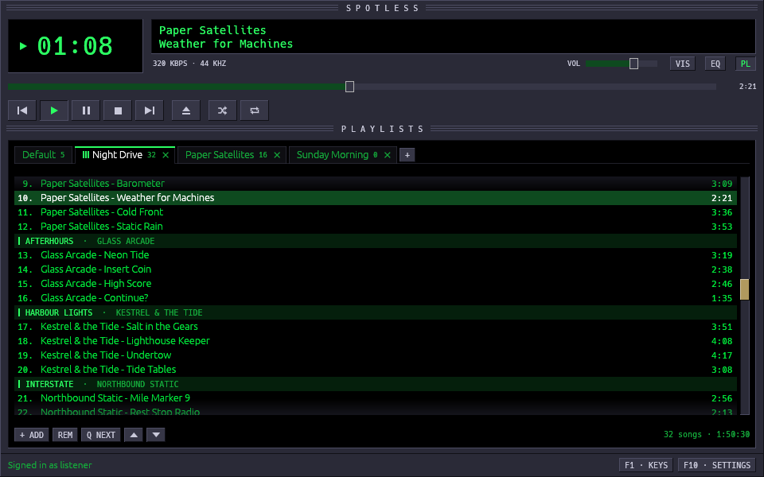

# Spotless

A small, fast Spotify player for the desktop and Android phones, in the
spirit of Winamp.
Local playlists, a straight path to any artist's albums, and nothing else in
the way.

Spotless runs on Linux, Windows and Android, and needs a Spotify Premium
account.

More in [Screenshots](docs/screenshots.md).

## How it's different

| | Spotify's app | Spotless |
|---|---|---|
| Speed | Heavy; screens and lists take a moment to load | Light and quick: it starts in a moment and responds at once |
| What plays | One queue, synced across your devices | Your own playlists, kept on this device and leaving your other devices alone; or, in the Spotify tab, your account's queue, shared as usual |
| Playing an album | Play replaces part of the queue; Add to queue puts it at the end | Add it to any playlist, or press Q to play songs next, without losing anything |
| After a song plays | It's gone from the queue | It stays; the playlist just moves on, so you can go back |
| Finding albums | Several screens, and the scroll position is lost | Search, then an artist's albums in date order, with songs opening inline |
| The screen | Home feeds, recommendations, podcasts and more | A player, your playlists, and the catalogue when you ask for it |
| The keyboard | A few shortcuts | Everything works from the keyboard (F1 lists the keys) |

## Features

- **Local playlists in tabs**, kept between sessions; playing a song
  doesn't use it up.
- **Browse**: search, then an artist's albums oldest first, songs opening
  inline; **+ ADD** puts a whole album in a playlist. Your Spotify
  playlists and Liked Songs are there too, to copy from, and songs or a
  whole tab can be copied to Spotify playlists (desktop).
- **Gapless playback** at 320 kbps, with Shuffle, Repeat and Play next.
- **Made for the keyboard**: everything works without the mouse.
- **Two looks**, Spotless Classic and Winamp Classic, in green, amber and
  five more colours.
- **An equaliser** and **the deck**, a Walkman, reel-to-reel, CD player or
  turntable beside the music's spectrum (desktop).
- **Last.fm scrobbling**, media keys, and a tray icon.

The whole list, and why Spotless exists, is in [About](docs/about.md).

It isn't for you if you rely on Spotify's own playlists, recommendations
or podcasts, or if you don't have Premium: Spotless leaves those out, and
Spotify only allows playback in other apps for Premium accounts.

## Install

### Windows

1. Download `spotless-<version>-windows-x64.zip` from the
   [Releases](https://github.com/nix-codes/spotless/releases) page.
2. Unzip it and run **install.cmd**. It installs Spotless for your user only
   (no administrator needed) to `%LOCALAPPDATA%\Programs\Spotless`, adds it to
   the Start menu, and lists it under *Settings > Apps* for uninstalling.
   Spotless says when a newer release is out and, once you agree, installs
   it (*Settings > About*); running a newer release's `install.cmd` updates
   it too.

   Or skip installing: `Spotless.exe` runs on its own from any folder.
3. Spotless isn't signed, so the first start may show *"Windows protected
   your PC"*: choose **More info**, then **Run anyway**.

To uninstall, use *Settings > Apps > Installed apps > Spotless*, or run
`uninstall.cmd`.

### Linux

For 64-bit PCs with glibc 2.35 or later (Ubuntu 22.04, Debian 12, Fedora 36
and newer).

1. Download `spotless-<version>-linux-x64.tar.gz` from the
   [Releases](https://github.com/nix-codes/spotless/releases) page and
   unpack it.
2. Run `./install.sh` in the `Spotless` folder. It installs
   `~/.local/bin/spotless` and a launcher with its icon, for your user only.
   Spotless says when a newer release is out and, once you agree, installs
   it (*Settings > About*); running a newer release's `install.sh` updates
   it too. `./uninstall.sh` removes it.

   Or skip installing: `./spotless` runs from the folder on its own.

Choosing the audio output needs PipeWire or PulseAudio (`pactl`), and the
tray icon needs a panel that shows StatusNotifierItem icons (KDE, most
others; on GNOME, the AppIndicator extension).

To build it from source instead, see [Development](DEVELOPMENT.md).

### Android

For 64-bit phones on Android 10 or later.

1. On your phone, download `spotless-android-<version>-arm64.apk` from the
   [Releases](https://github.com/nix-codes/spotless/releases) page (the
   releases named *Spotless for Android*).
2. Open it to install it. Android asks once to allow installing apps from
   your browser or file manager.
3. Spotless isn't on Google Play, so Play Protect may warn that it doesn't
   know the app: choose to install it anyway.

To update, install a newer release's APK over it; your playlists and
sign-in stay. [Obtainium](https://github.com/ImranR98/Obtainium) can watch
the Releases page and install new versions for you.

Each release lists the SHA-256 fingerprint of the certificate it's signed
with; every release is signed with the same one.

## First start

On Android, *Settings* is the ☰ button at the top, and the Client ID goes
under *Search* there, with **CONNECT** to approve it.

1. **Sign in.** Click *Sign in with Spotify*: your browser opens once for
   Spotify's approval, and Spotless remembers it.
2. **Set up search** (once). Spotify only lets third-party players search
   through a Spotify app of your own, which is free to make:
   1. Create an app at
      [developer.spotify.com/dashboard](https://developer.spotify.com/dashboard).
   2. Add `http://127.0.0.1:8989/login` as its Redirect URI, and tick
      **Web API**.
   3. Paste the app's Client ID in Spotless: *Settings (F10) > Account*.
      Your browser asks once more, to approve search.

   The steps are also in that settings page, with a button to copy the
   Redirect URI. Playlists and playback work without it; only search needs
   it.

3. **Connect Last.fm** (optional, once). Last.fm needs an API account of
   your own, also free:
   1. Create one at
      [last.fm/api/account/create](https://www.last.fm/api/account/create).
      Any application name will do; leave the callback URL empty.
   2. Paste its API key and shared secret in *Settings (F10) > Last.fm* and
      click **CONNECT**. Your browser asks you to allow Spotless.

   [Why an API account of your own?](docs/about.md#lastfm)

Press **F1** at any time for the keys.

## More

- [Screenshots](docs/screenshots.md): both looks, the colours, the deck and
  the Android app.
- [About](docs/about.md): the name, why Spotless exists, who it's for, every
  feature, where your data is kept, and how far along it is.
- [Development](DEVELOPMENT.md): building from source, the checks, and
  releasing.

## Credits

Spotless started from [spotifast](https://github.com/crmne/spotifast) by
Carmine Paolino: its sign-in, playback and catalogue code were the base this
player was trimmed and reshaped from.

It plays through [librespot](https://github.com/librespot-org/librespot)
(a fork with a few fixes not yet released) and draws its window with
[egui](https://github.com/emilk/egui).

The deck was inspired by [Deck 90](https://github.com/djkollmax/deck-90)
by djkollmax, a retro hi-fi audio analyser with spinning cassettes and LED spectrums.
It's lettered in [Permanent Marker](https://fonts.google.com/specimen/Permanent+Marker)
by Font Diner (Apache License 2.0) and
[Audiowide](https://fonts.google.com/specimen/Audiowide) by Astigmatic (SIL
Open Font License 1.1); their licences are beside them in
`src/ui/deck/fonts`.

Spotless is not made or endorsed by Spotify. Spotify is a trademark of
Spotify AB.

## License

MIT: see [LICENSE](LICENSE). It covers Spotless and the code that came from
spotifast.
