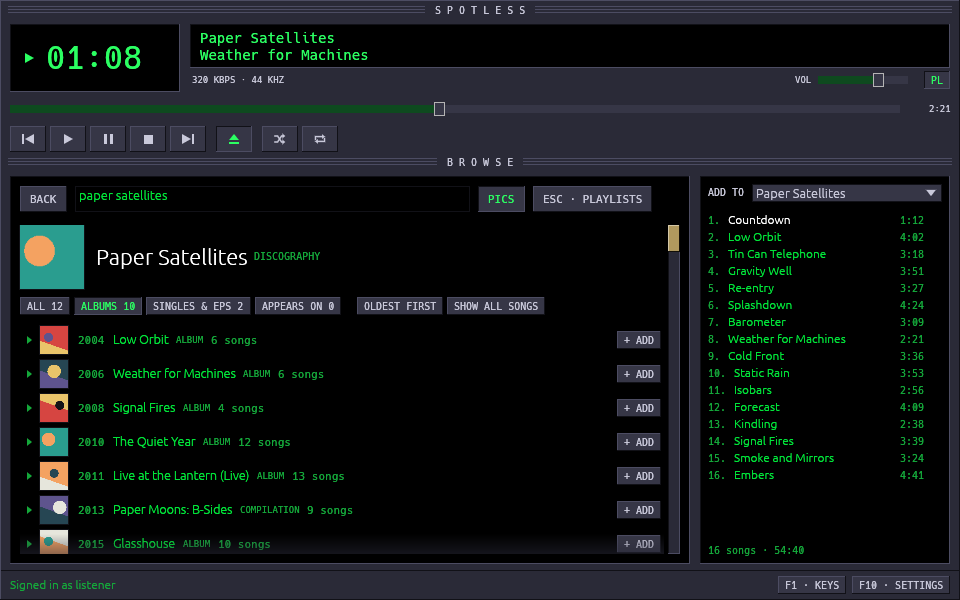
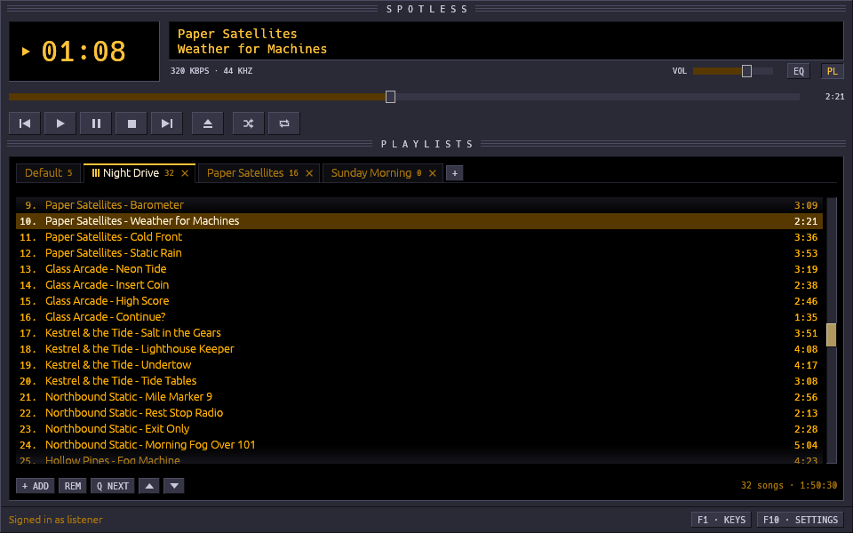
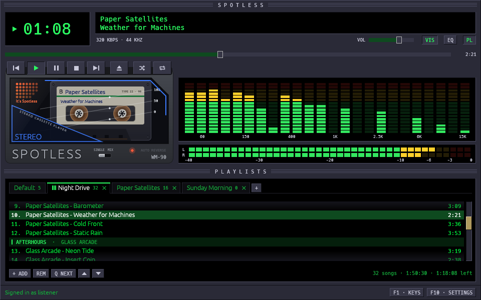
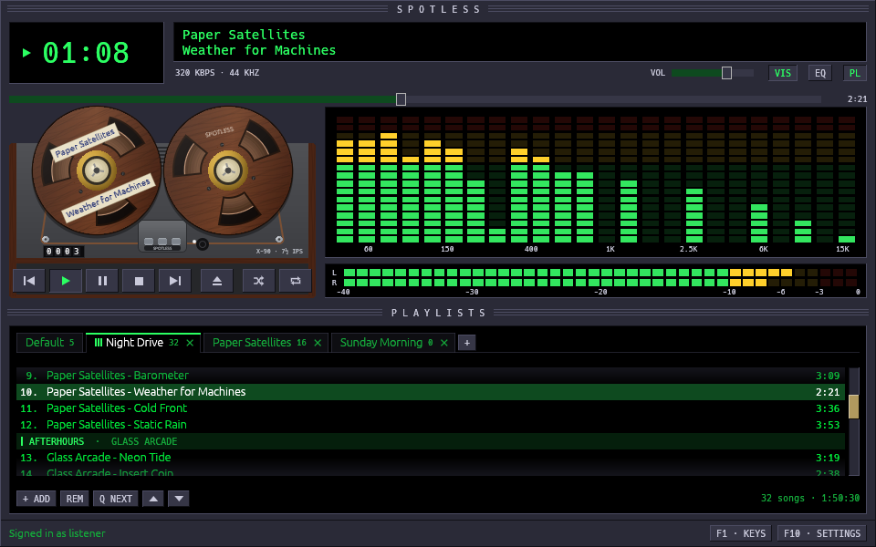
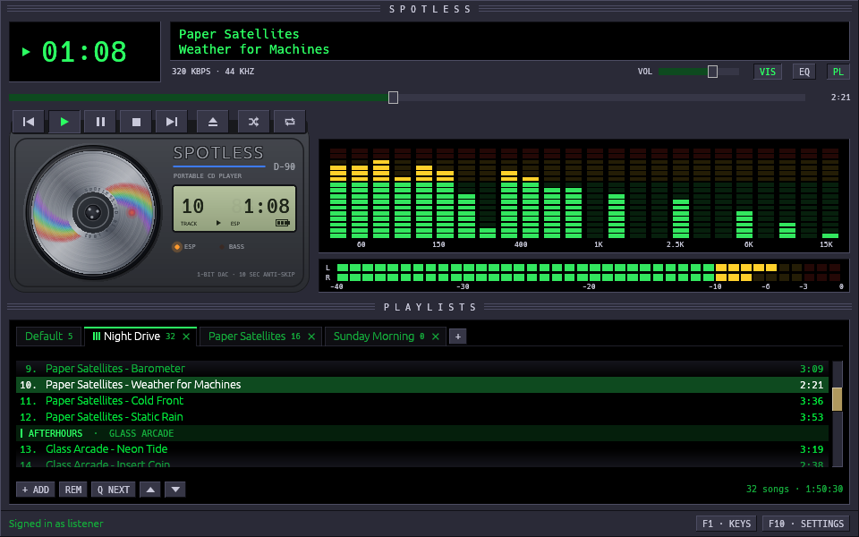
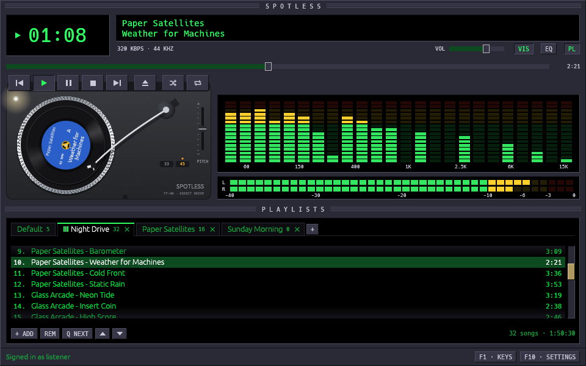
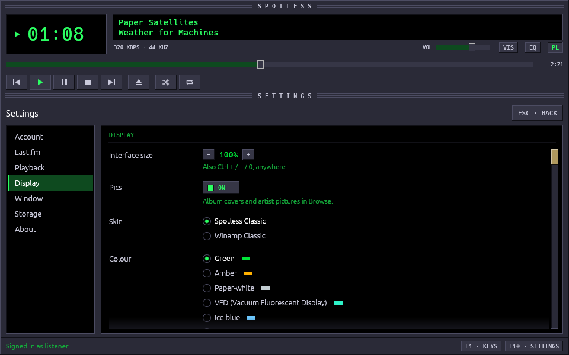
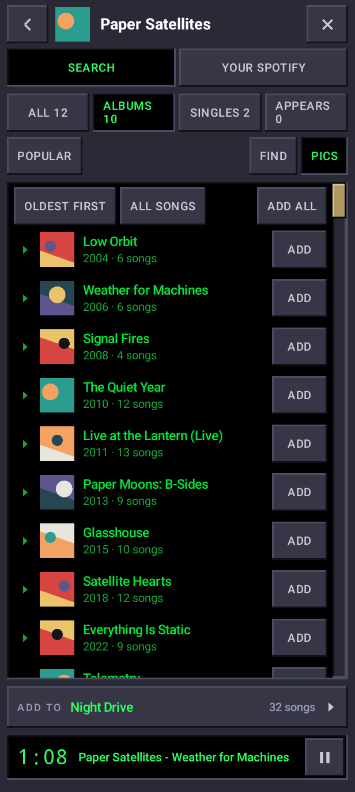

# Screenshots

[Back to Spotless](../README.md)

The playlists in the Winamp Classic look, and Browse in Spotless Classic:

<table>
<tr>
<td></td>
<td></td>
</tr>
</table>

The colour of the lists and the display, chosen in Settings: green, amber
and five more.

<table>
<tr>
<td> Green</td>
<td> Amber</td>
</tr>
</table>

The deck (VIS), on each of its four players:

<table>
<tr>
<td> Walkman</td>
<td> Reel-to-reel</td>
</tr>
<tr>
<td> CD player</td>
<td> Turntable</td>
</tr>
</table>

The settings, where the look and the colour are chosen:

The Android app, playing a playlist and browsing an artist's albums:

<table>
<tr>
<td></td>
<td></td>
</tr>
</table>
